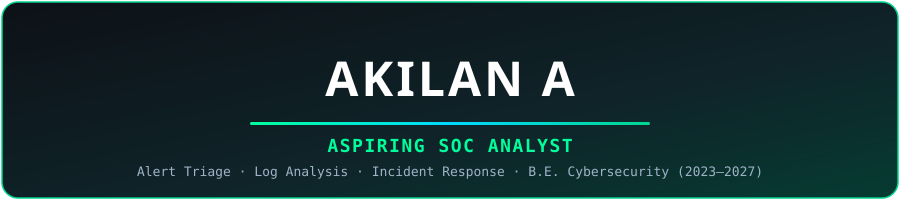

  

<h1 align="center">AKILAN A</h1>

  

  
  
  
  
  

  <a href="#about-me">About</a> ·
  <a href="#tech-arsenal">Tech Arsenal</a> ·
  <a href="#featured-projects">Projects</a> ·
  <a href="#achievements">Achievements</a> ·
  <a href="#github-analytics">GitHub Analytics</a> ·
  <a href="#lets-connect">Connect</a>

## About Me

<picture>
  <source media="(prefers-color-scheme: dark)" srcset="assets/terminal.svg" />
  <source media="(prefers-color-scheme: light)" srcset="assets/terminal.svg" />
  
</picture>

  

Final-year B.E. Cybersecurity student at Sethu Institute of Technology (2023–2027), seeking a **SOC Analyst L1** role focused on alert triage, log analysis, and incident response. Open to 24×7 shift-based operations.

## Tech Arsenal

  
<strong>Languages</strong>

  
  
  
  

  
<strong>Security Tools</strong>

  **SOC & Operations**  
  
  
  
  
  
  
  
  
  
  

  **Offensive & Assessment Tools**  
  
  
  
  
  
  
  
  
  
  
  
  

  **Forensics, Integrity & Cryptography**  
  
  
  
  
  
  
  
  
  
  
  
  
  
  

  
<strong>Networking</strong>

  
  
  
  

  
<strong>OS & Environments</strong>

  
  
  
  
  

  
<strong>Web Security</strong>

  
  
  
  
  
  
  

  
<strong>Databases & Dev Tools</strong>

  
  
  
  
  
  
  
  
  

## Featured Projects

  
<strong>XtractR — Android Mobile Forensics Toolkit</strong>

  - **Focus:** Detecting evidence-dataset tampering and supporting independent verification of chain of custody.
  - **Implementation:** Deterministic SHA-256 hashing pipelines, Merkle-root verification, tamper-evident hash-chained custody ledger with Ed25519-signed case exports, and a plugin-based architecture for Android artifact extraction and validation.
  - **Tech stack:** Python, SHA-256, Merkle Trees, Ed25519, SQLite, JSONL.
  - **Repository:** [github.com/Akilan4757/XtractR](https://github.com/Akilan4757/XtractR)

  
<strong>DenyFS — Encrypted Container Filesystem with Hidden Volume</strong>

  - **Focus:** Local encrypted storage on Linux and WSL2 with an outer volume and an optional hidden volume under a separate passphrase.
  - **Implementation:** C11 filesystem mounted via FUSE3; Argon2id key derivation, AES-256-GCM authenticated volume headers, AES-256-XTS encryption for 4096-byte blocks, and HMAC-SHA256 allocation-bitmap integrity checks. Includes a loopback-only Python dashboard, verification suite (crypto, sector I/O, FUSE, timing, stress, fuzzing), CI, and threat-model/benchmark documentation.
  - **Tech stack:** C11, FUSE3, libsodium, OpenSSL, Python.
  - **Repository:** [github.com/Akilan4757/Denyfs](https://github.com/Akilan4757/Denyfs)

## Achievements

  
<strong>Certifications</strong>

  - Microsoft Certified: Security Operations Analyst (SC-200) — Microsoft
  - Certified Network Security Practitioner (CNSP) — The SecOps Group
  - Jr Penetration Tester — TryHackMe
  - Cloud Computing — NPTEL, IIT
  - Networking Basics — Cisco

  
<strong>Experience, Recognition & Leadership</strong>

  - **2023–2027:** B.E. Cybersecurity, Sethu Institute of Technology (CGPA 7.5/10).
  - **October 2025–March 2026:** Cybersecurity Analyst Intern, DaleEdge (Madurai, India) — incident-response SOPs and checklists, Jira vulnerability tracking, OWASP Top 10 assessments in internal test environments, and build-security reviews.
  - **October 2026:** NASA Vulnerability Disclosure Program — recognition letter from NASA's Senior Agency Information Security Officer, Office of the Chief Information Officer.
  - **Acer Security Appreciation:** Independently reported a web-application vulnerability; confirmed and remediated with a written appreciation letter.
  - **2024–2025:** Best Student of the Year, Department of CSE (Cybersecurity), Sethu Institute of Technology.
  - **TryHackMe:** Top 1% globally, 180+ rooms completed ([Profile](https://tryhackme.com/p/Akilan47)).
  - **CTFs:** Honeynet Collapse CTF (Rank 439) · Hackfinity Battle CTF (Rank 741).
  - **Leadership:** Admin at [Sudo Society](https://sudosocietyctf.unaux.com) (campus cybersecurity & CTF platform); President, Toastmasters Club (Distinguished Status over 11-month term, Path Completion Award).

## GitHub Analytics

  <picture>
    <source media="(prefers-color-scheme: dark)" srcset="https://github-readme-stats.vercel.app/api?username=Akilan4757&show_icons=true&theme=dark&title_color=00FF9C&text_color=E6EDF3&icon_color=00D9FF&hide_border=true" />
    <source media="(prefers-color-scheme: light)" srcset="https://github-readme-stats.vercel.app/api?username=Akilan4757&show_icons=true&theme=default&title_color=007E6B&text_color=1F2937&icon_color=007E87&hide_border=true" />
    
  </picture>
  <picture>
    <source media="(prefers-color-scheme: dark)" srcset="https://github-readme-stats.vercel.app/api/top-langs/?username=Akilan4757&layout=compact&theme=dark&title_color=00FF9C&text_color=E6EDF3&hide_border=true" />
    <source media="(prefers-color-scheme: light)" srcset="https://github-readme-stats.vercel.app/api/top-langs/?username=Akilan4757&layout=compact&theme=default&title_color=007E6B&text_color=1F2937&hide_border=true" />
    
  </picture>

  <picture>
    <source media="(prefers-color-scheme: dark)" srcset="https://streak-stats.demolab.com/?user=Akilan4757&theme=dark&hide_border=true&ring=00FF9C&fire=00D9FF&currStreakLabel=00FF9C&sideLabels=00D9FF" />
    <source media="(prefers-color-scheme: light)" srcset="https://streak-stats.demolab.com/?user=Akilan4757&theme=default&hide_border=true&ring=00A67D&fire=007E87&currStreakLabel=007E6B&sideLabels=007E87" />
    
  </picture>

<picture>
  <source media="(prefers-color-scheme: dark)" srcset="https://github-readme-activity-graph.vercel.app/graph?username=Akilan4757&bg_color=0d1117&color=00d9ff&line=00ff9c&point=00d9ff&hide_border=true" />
  <source media="(prefers-color-scheme: light)" srcset="https://github-readme-activity-graph.vercel.app/graph?username=Akilan4757&bg_color=ffffff&color=0d1117&line=00a67d&point=007e87&hide_border=true" />
  
</picture>

## Let's Connect

  
  
  

